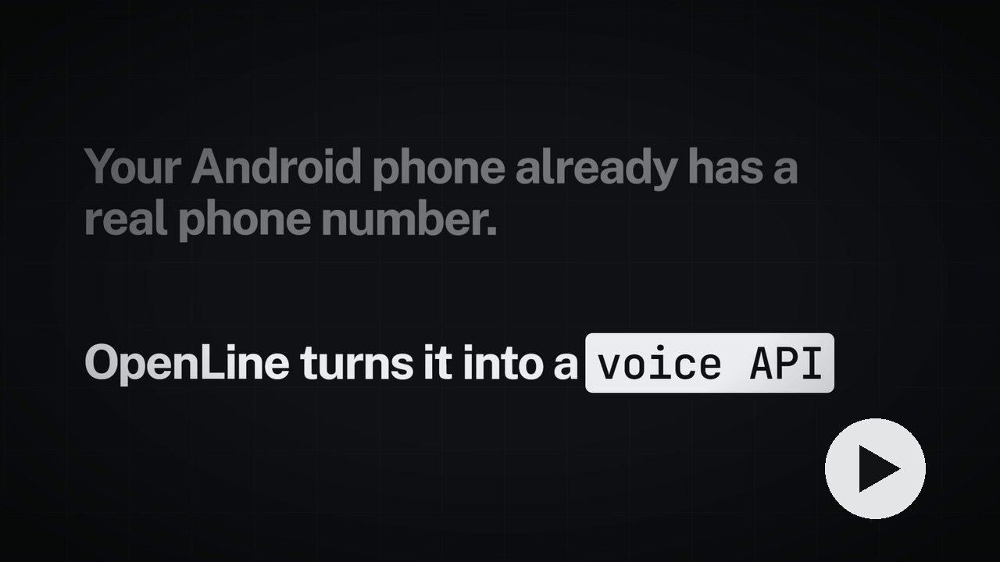

# OpenLine

**Your Android phone's SIM, as a voice API.** OpenLine is an open-source, self-hosted alternative
to Twilio Voice: an Android phone places and answers real phone calls on its SIM, and your code or
AI voice agent controls them over REST and talks through WebSockets.

**[Documentation](https://manohar-k-reddy.github.io/openline/)** ·
[Quickstart](https://manohar-k-reddy.github.io/openline/start/quickstart/) ·
[Connect an AI agent](https://manohar-k-reddy.github.io/openline/guides/agent-streams/) ·
[API reference](https://manohar-k-reddy.github.io/openline/api/) ·
[llms.txt](https://manohar-k-reddy.github.io/openline/llms.txt)

[](https://manohar-k-reddy.github.io/openline/media/openline-explainer.mp4)

```bash
curl -X POST https://your-openline.example/v1/calls \
  -H "Authorization: Bearer $OPENLINE_KEY" -H "content-type: application/json" \
  -d '{"deviceId":"phone-7f3a91c2","to":"+919876543210",
       "stream":{"url":"wss://my-agent.example.com/ws","format":"twilio"}}'
```

The phone dials. When the call is answered, OpenLine connects it to your agent's WebSocket and
streams the conversation both ways. Your agent hangs up by closing the socket.

## Features

- **Calls API:** place, answer, reject, hang up, hold and send DTMF with plain HTTP requests.
  Every call, event and transcript is stored and queryable.
- **AI agents on real calls:** the server streams calls to your agent's WebSocket as raw 16 kHz
  PCM or in Twilio Media Streams format, so Pipecat and other Twilio-ready agents work as they are.
  Outgoing and incoming calls.
- **Webhooks:** signed (HMAC-SHA256) call events with retries and a delivery log.
- **Built-in assistant:** an optional Gemini Live receptionist that answers your calls and takes
  messages.
- **Silent phone, no root:** the phone only routes the call; audio never plays on the handset. One
  APK, no Shizuku, no PC, no extra hardware.
- **Console:** sign in, pair phones by QR code, watch phone health, test calls from the browser,
  manage API keys and settings.
- **Self-hosted:** one Node.js process and one SQLite file. Expose it with Tailscale Funnel or
  Cloudflare Tunnel.

## How it works

```text
 Caller ── mobile network ── Android phone (OpenLine app)
                                   │  WebSocket: commands, events, call audio
                                   ▼
                            OpenLine server ── webhooks ──▶ your backend
                                   │
                    REST + WebSocket
                                   ▼
                  your code / AI agent (Pipecat, LiveKit worker, custom)
```

## Quick start

Needs Node.js 22.13+ and an Android 11+ phone with a SIM.

```bash
git clone https://github.com/Manohar-k-Reddy/openline.git
cd openline/server
cp .env.example .env          # set HTTP_GATEWAY_API_KEY to a long random string
npm install && npm run build && npm start
```

On Windows, double-click `run-server.bat` instead. Then:

1. Open `http://localhost:8787/` and create your account.
2. Give the server a public address: `tailscale funnel --bg 8787` (or a Cloudflare Tunnel), and
   save it in **Settings**.
3. Install the APK from [Releases](https://github.com/Manohar-k-Reddy/openline/releases) on the
   phone, open **Connection** in the console and scan the QR code with the app.
4. Create an API key in **Settings** and place a call.

The [Quickstart](https://manohar-k-reddy.github.io/openline/start/quickstart/) walks through every
step.

## Repository

| Folder | What's in it |
|---|---|
| [`server/`](server/) | Node.js + TypeScript server: REST API, WebSockets, console, SQLite |
| [`android/`](android/) | The OpenLine Android app (Kotlin) |
| [`docs-site/`](docs-site/) | Documentation site (Astro Starlight), API spec, llms.txt |
| [`simulator/`](simulator/) | Mock phone, media client and an example echo agent |
| [`docs/notes/`](docs/notes/) | Historical development notes |

## Status

OpenLine is a v1, tested end to end on a Vivo V40 with Android 16: outgoing and incoming carrier
calls, two-way call audio, AI agents on calls, and a silent handset. Call audio depends on
Android behaviour that can differ between phone makers; reports from other phones are welcome.

Not included yet: SMS, call recording, conferencing and TwiML-style call flows.

## Responsible use

You're responsible for the calls you place. Follow local laws on automated calls, telling people
they're talking to an AI, and recording consent.

## License

[MIT](LICENSE)
